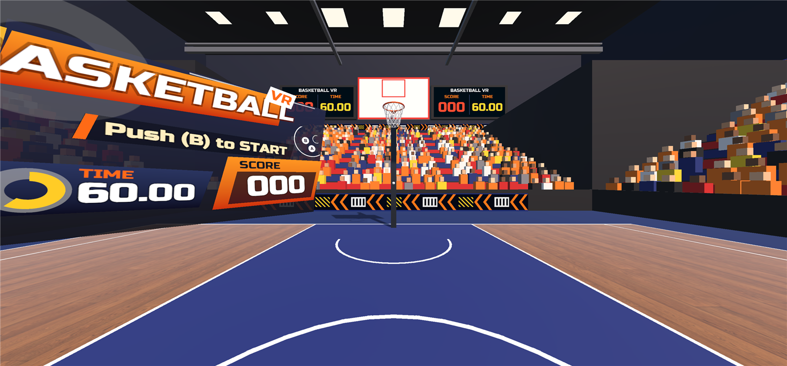
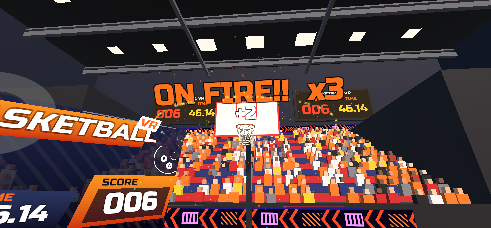
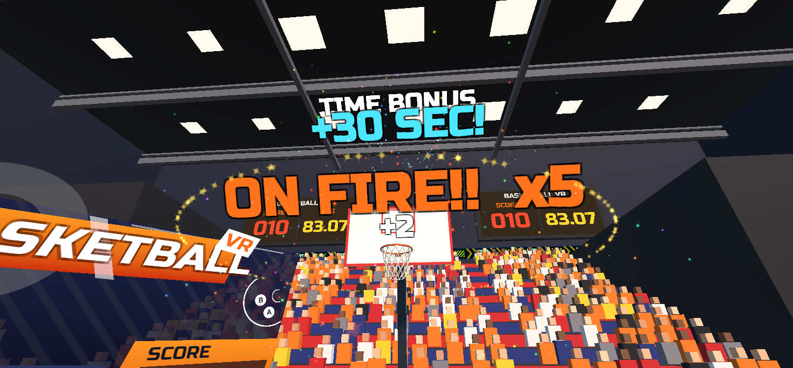
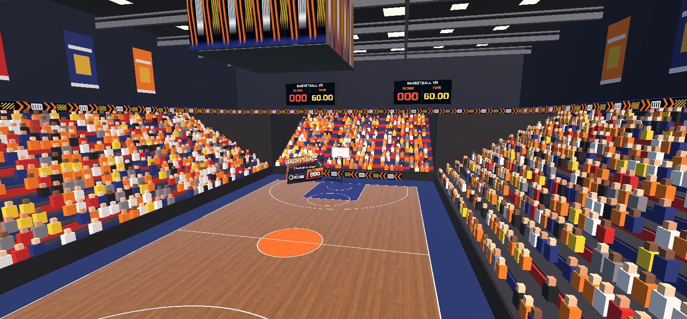

# Basketball VR

Meta Quest 向けのバスケットボール VR ゲーム（Unity 6 / URP / Meta XR SDK）。
観客でいっぱいのアリーナで、制限時間内にボールを何本ゴールに入れられるかを競う。

## 遊び方
- 開始すると手元にボールが出てくる。掴んでリングに投げ入れると 1 本 2 点。
- 制限時間は 60 秒。**10 点で +30 秒、30 点でさらに +30 秒**延長される。
- 3 本続けて入れると **ON FIRE**。ボールが燃え、演出もどんどん派手になる。外すと元に戻る。

| ゴール（ON FIRE） | タイムボーナス |
|---|---|
|  |  |

## 操作
| | 素手 (Quest ハンドトラッキング) | コントローラー (Quest) | PC (エディタ) |
|---|---|---|---|
| 開始 | どちらかの手でピンチ（親指と人差し指をつまむ） | B ボタン | B キー |
| 掴む | 右手のひらをボールに触れる | 右トリガーを握る | Space を押す |
| 投げる | 手首のスナップで自動的に指先から離れる | 手首のスナップ（トリガーを離しても投げられる） | マウスを動かしながら Space を離す |
| タイトルへ戻る | ピンチを 3 秒続ける | A ボタン 3 秒長押し | A キー 3 秒長押し |

## アリーナ

- 実寸（FIBA 規格 28m × 15m）のコートと、約 2,000 人が座る観客席。
- ゴールすると観客がブロックごとに跳ね、客席のあちこちでカメラのフラッシュが光り、LED のリボンボードが虹色に光る。
- ゴール裏のスコアボード 2 枚に、得点と残り時間が表示される。
- Quest で軽く動くよう、色は 1 枚のパレットテクスチャで塗り分け、照明は光る板で表現している（リアルタイムのライトや影は増やしていない）。

## 音と演出
| 場面 | 音 | 演出 |
|---|---|---|
| 開始 | ホイッスル・BGM（ループ） | 「GO!!」・紙吹雪 |
| ゴール | スウィッシュ・歓声 | ネットが揺れる・紙吹雪・リムが光る・得点のポップアップ |
| リム／ボード／支柱に当たる | 金属音／「ドン」 | 当たった物が揺れる |
| 床で弾む | バウンド音 | 床に小さな輪が広がる |
| タイムボーナス | 高めのホイッスル | 「+30 SEC!」・時間表示が水色に弾む |
| 時間切れ | ブザー・拍手・大歓声 | 「TIME UP!」・大量の紙吹雪とフラッシュ |

プレイ中はずっと観客のざわめきが流れていて、盛り上がるほど大きくなる。

## 調整できるところ
| 何を | どこで |
|---|---|
| 制限時間・タイムボーナスの節目と秒数 | `Manager` の GameManager → `Limit Time` / `Time Bonuses`（点数の小さい順に並べる） |
| 1 ゴールの得点 | GameManager → `Goal Point` |
| ON FIRE になる連続ゴール数 | `Manager` の FxManager → `Fire Combo` |
| ざわめきの音量 | `Arena` の ArenaFx → `Ambient Idle` / `Ambient Play` |

## アリーナと効果音の作り直し
アリーナと効果音の一部は、エディタのスクリプトで生成している。数値を変えたら、メニューから作り直す。

| メニュー | スクリプト | 作るもの |
|---|---|---|
| `Tools > Basketball > Build Arena` | `Assets/Editor/ArenaBuilder.cs` | シーンの `Arena`（コートライン・観客席・観客・壁・天井・LED ボード・スコアボード）と `Assets/Arena/` のメッシュ・素材 |
| `Tools > Basketball > Generate Sounds` | `Assets/Editor/SfxSynth.cs` | `Assets/Sounds/Generated/`（リム・ボード・ホイッスル・歓声・拍手・ざわめき） |

Build Arena は、リングとボードに当たった音の設定（`SurfaceSound`）や、各演出の参照もつなぎ直す。

## 主なスクリプト（`Assets/Scripts/`）
| ファイル | 役割 |
|---|---|
| `GameManager.cs` | ゲームの進行（タイトル・プレイ・時間切れ）、得点、タイムボーナス、ボールの出現 |
| `FxManager.cs` | ゴール・コンボ・時間切れの演出（紙吹雪・ポップアップ・ネット・ボールの軌跡） |
| `ArenaFx.cs` | アリーナの演出（観客・フラッシュ・LED ボード）と観客の音 |
| `BallAction.cs` | ボールの物理（空気抵抗・スピン）、ゴール判定の報告、バウンド音 |
| `SurfaceSound.cs` | リム・ボード・支柱に当たった時の音と揺れ |
| `HandAction.cs` / `BallHoldPose.cs` | 掴む・投げる（ハンドトラッキングとコントローラー） |
| `TutorialGuide.cs` | 最初の 1 投の投げ方の案内 |

## 素材のライセンス
外部の素材は `Assets/ThirdParty/` にまとめている。詳しくは `Assets/ThirdParty/CREDITS.md` を参照。
- BGM「Basketball Training」（Arulo）と、スウィッシュ・ブザー・バウンド・キャッチの音：[Mixkit](https://mixkit.co/)（Mixkit License。ゲームの中で使うのは自由。素材だけを再配布するのは不可）
- 床の木目・体育館の HDRI：[Poly Haven](https://polyhaven.com/)（CC0）
- パーティクルの画像：[Kenney](https://kenney.nl/)（CC0）
- フォント Russo One：Google Fonts（SIL Open Font License 1.1）

## Git に入れるもの
`Assets/` `Packages/` `ProjectSettings/` `Docs/` `.gitignore` `.mcp.json` `README.md`

`Library/`（数 GB）は Unity が自動生成するキャッシュなので入れない（`.gitignore` 済み）。
Meta XR SDK などのパッケージは `Packages/manifest.json` に書かれているだけで、開いたときに自動でダウンロードされる。

## 空のリポジトリへ移す手順
1. GitHub で空のリポジトリを作り、クローンする
2. このフォルダから上記のファイル・フォルダをクローン先にコピーする
3. クローン先を Unity Hub で開く（初回は `Library/` の再生成で時間がかかる）
4. `git add .` → `git commit` → `git push`
